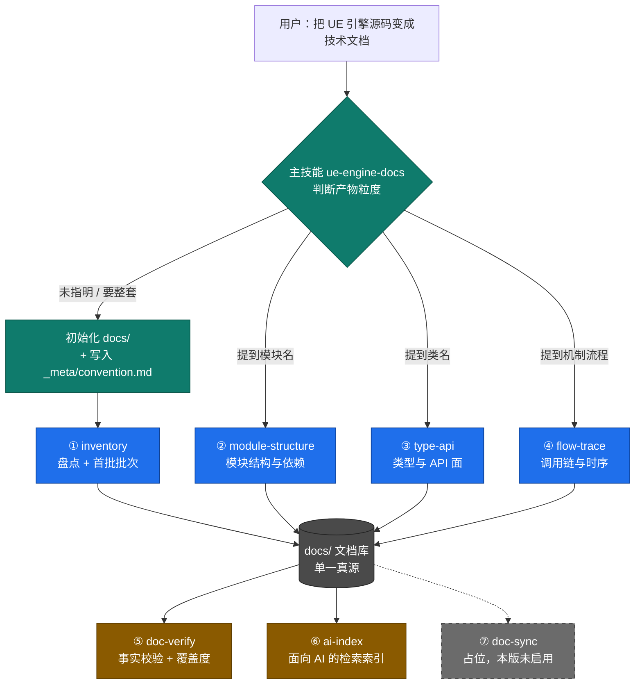

# UE5 引擎源码技术文档技能套件 · 设计说明

| 项 | 值 |
|---|---|
| 引擎版本 | UE 5.8.3 (Build 58210709)，锁定单版本 |
| 引擎安装根 | `E:\EpicGames\UE_5.8` |
| 文档语言 | 中文为主；类名 / 函数名 / 宏 / 文件名 / 配置项一律保留英文原名 |
| 首批范围 | 10 个高频模块，约 8,673 文件（其中 5,366 个头文件） |
| 文档库 | 仓库根 `docs/` |
| 技能安装 | 项目级 `.codebuddy/skills/ue-engine-docs-suite/` |
| 版本 | v1.0 / 2026-10-10 |

---

## 1. 目标与非目标

### 1.1 目标

1. **给人看**：让程序员能按「引擎 → 模块 → 类型 → 流程」四级路径，快速定位并理解某个引擎实现。
2. **给 AI 用**：让 AI 辅助编写 Gameplay 代码时，能检索到**可核验**的引擎 API 与约定（精确到文件路径与行号），而不是靠记忆猜 API。

### 1.2 非目标（明确排除，防止范围蔓延）

| 不做 | 原因 |
|---|---|
| 逐行翻译 / 注释引擎源码 | 无边际收益，且无法校验 |
| `ThirdParty`（31,021 文件）文档 | 第三方库噪声，非 Epic 实现 |
| `Editor` / `Developer` / `Programs` / `Platforms` 层 | 本版服务 Gameplay 开发，不服务工具链与编辑器扩展 |
| 跨引擎版本维护 | 本版锁定 5.8，`ue-doc-sync` 仅留占位 |
| 可编译的示例工程 | 只产出文档，不产出工程代码 |

---

## 2. 量级与现状

实测（2026-10-10，`scan-engine.ps1` 直跑）：

| 类别 | 模块数 | 模块内文件数 |
|---|---|---|
| `Runtime` | 291 | 19,221 |
| `Plugins/*` | ~1,788 | 56,780 |
| `Editor` | 145 | 8,343 |
| `Developer` | 164 | 3,541 |
| `Platforms` | 12 | 47 |
| `Programs` | 2 | 37 |
| `Shaders` | 1 | 1,227 |
| `ThirdParty` | 已排除 | 31,021（目录总量） |
| **合计** | **2,403** | **89,196** |

> 上表为引擎**重装补齐源码后**的数据。重装前（仅头文件安装）总文件数为 52,157，
> **模块数 2,403 未变**。两次实测的对照与原因见第 14、15 节。

**两条与直觉相反的结论，直接决定了整套设计：**

1. **模块总数是 2,403，不是 300。** `Runtime` 只有 291 个，大头在 `Plugins`（约 1,788）。
   设计初期按"300 个模块"做的估算偏了一个数量级——这恰好放大了"不要按模块拆技能"的必要性。
2. **目录文件数 ≠ 模块文件数。** `Programs` 目录有 2,985 个文件，但只有 2 个 UE 模块（合计 30 个文件），
   其余全是 C# 构建工具链。规模统计必须按模块口径，不能按目录口径。

与单体项目分析技能的形态差异：

| 维度 | 单体项目分析技能 | UE5 引擎源码 |
|---|---|---|
| 规模 | 百来个类 | 2,403 模块 / 5.2 万文件 |
| 噪声 | 无 | ThirdParty 占目录量四成 |
| 模块粒度 | 1 个 Game 模块 | 2,403 模块，多层嵌套、插件分组组织 |
| 版本敏感 | 弱 | 极强 |
| 消费方 | 人 | 人 + AI（要求机检锚点） |

**结论**：不能笼统地写成一个"更大的单体分析技能"，须升级为 **「主技能编排 + 单一职责子技能 + 共享文档库」**。

---

## 3. 拆分方法论

### 3.1 独立成技能的三问判据

| 判据 | 不通过的后果 |
|---|---|
| ① 能否一句话说清「输入 X → 单一产物 Y → 给消费者 Z」？ | 说不清 = 职责未想清，先别拆 |
| ② 能否被独立触发（用户可能只想做这一步）？ | 只能跟主流程跑 = 该沉为主技能下的 `steps/` 文档 |
| ③ 改动频率是否与其他部分显著不同？ | 一起改的两处 = 应合并 |

**三问全"是"才独立成技能**，否则降级为步骤文档或数据文件。

### 3.2 三根拆分轴的取舍

| 拆分轴 | 采用 | 理由 |
|---|---|---|
| **A. 按产物粒度**（引擎 → 模块 → 类 → 流程） | ✅ 主用 | 产物模板不同、触发词不同、可独立使用 |
| **B. 按流程阶段**（盘点 → 生产 → 校验 → 维护） | ✅ 辅用 | 校验 / 维护有独立触发场景，改动频率远低于分析 |
| **C. 按引擎子系统**（渲染 / GC / GAS / 网络 …） | ❌ 否决 | 见 3.3 |

最终形态：**主技能编排（B）+ 子技能按产物粒度拆（A）+ 子系统用数据文件承载（C）**。

### 3.3 为什么否决"按引擎模块垂直拆"

实测 2,403 个模块，按模块拆技能会带来三重代价：

1. 2,403 个技能，Level 1 常驻元数据被彻底吃光；
2. 2,403 个 description 必然互相抢触发，AI 无法判断该用哪个；
3. 模块清单是**数据**不是**能力**，用一份 `engine-modules.json` + 一份 `subsystem-catalog.md` 即可承载。

> **原则：把"多"留给数据文件，把"专"留给技能。**

---

## 4. 套件蓝图

```
UE5AIRead/
├── .codebuddy/skills/
│   └── ue-engine-docs-suite/           # 套件目录（2026-10-10 收拢，见第 19 节）
│       ├── 使用说明.md                  # 面向使用者：怎么用这套技能
│       ├── ue-engine-docs/             # ★ 主技能：编排 + 规范契约 + 索引
│       │   ├── SKILL.md
│       │   ├── assets/
│       │   │   └── convention-template.md  # 规范结构模板
│       │   ├── references/
│       │   │   └── subsystem-catalog.md    # 子系统分类目录（决策 C 的承载物）
│       │   ├── scripts/
│       │   │   └── check-source.ps1        # 源码形态复核（Complete / HeadersOnly）
│       │   └── evaluation/                 # 触发/效果评估用例
│       ├── ue-engine-inventory/        # ① 生产：盘点与批次界定
│       │   ├── SKILL.md
│       │   ├── scripts/
│       │   │   └── scan-engine.ps1         # 引擎根 -> 模块清单 JSON
│       │   └── evaluation/
│       ├── ue-module-structure/        # ② 生产：模块结构与依赖（含 evaluation/）
│       ├── ue-type-api/                # ③ 生产：类型与 API 面（含 evaluation/）
│       ├── ue-flow-trace/              # ④ 生产：调用链与机制（含 evaluation/）
│       ├── ue-doc-verify/              # ⑤ 保障：事实校验 + 覆盖度
│       │   ├── SKILL.md
│       │   ├── scripts/
│       │   │   └── verify-refs.ps1         # 机器初筛：引用存在性 / 行号越界
│       │   └── evaluation/
│       ├── ue-ai-index/                # ⑥ 保障：面向 AI 的检索索引（含 evaluation/）
│       └── ue-doc-sync/                # ⑦ 占位：升版增量维护（本版不启用）
└── docs/                               # ★ 文档库：唯一产物，随仓库版本控制
    ├── _meta/
    │   ├── convention.md               # 规范：模板/命名/标注/链接（单一真源）
    │   ├── inventory.md                # 产物：引擎盘点与首批批次
    │   ├── engine-modules.json         # 数据：2,403 行模块清单（机器可读）
    │   ├── quality-report.md           # 产物：文档校验报告
    │   └── skill-suite-assessment.md   # 产物：技能套装评估报告
    ├── 00-索引.md                      # 产物：全库索引
    ├── modules/<模块>-结构.md          # 产物：②
    ├── types/<类名>.md                 # 产物：③
    ├── flows/<机制名>.md               # 产物：④
    └── ai/ai-index.md                  # 产物：⑥
```

### 4.1 两处刻意的设计选择

**选择一：文档写在仓库根 `docs/`，不写在技能目录下。**
单体项目分析技能把知识文档放在自己的 `references/` 里。本套件改到 `docs/`：

| 原因 | 说明 |
|---|---|
| 文档要能脱离技能被分享 | 技能是可替换工具，文档是资产 |
| 文档要能被 git 追踪与 review | 和技能代码分离，diff 更干净 |
| 规范要被所有技能引用 | 放在随文档库走的固定路径，避免跨技能相对路径失效 |

**选择二：脚本跟着唯一消费者走。**
`scan-engine.ps1` 只被 ① 使用，就放在 ① 的 `scripts/` 下，不放主技能。
避免"共用脚本目录"这种伪复用——一旦有第二个消费者再提上来。

---

## 5. 技能职责卡

| # | 技能 | 输入 | 唯一产物 | **明确不做** | description 锚点 |
|---|---|---|---|---|---|
| ★ | `ue-engine-docs` | 笼统意图 | `docs/` 初始化 + `00-索引.md` | 不亲自做分析，下发给子技能 | 整套 / 知识库 / 未指明粒度 |
| ① | `ue-engine-inventory` | 引擎根 + 版本 | `_meta/inventory.md` | 不读模块内部实现 | 模块清单 / 源码规模 / 有哪些模块 |
| ② | `ue-module-structure` | 模块名 | `modules/<X>-结构.md` | 不逐个类展开、不追调用链 | 模块 / `Build.cs` / 依赖 |
| ③ | `ue-type-api` | 类名或头文件路径 | `types/<类>.md` | 不写跨类流程 | 类 / `UCLASS` / API / 虚函数 |
| ④ | `ue-flow-trace` | 机制名 | `flows/<机制>.md` | 不重复类型字段细节（引用 `types/`） | 流程 / 调用链 / 时序 / 机制 |
| ⑤ | `ue-doc-verify` | `docs/` + 引擎根 | `_meta/quality-report.md` + 修正清单 | 不新增事实内容 | 校验 / 核对 / 准确性 |
| ⑥ | `ue-ai-index` | `docs/` 既有文档 | `ai/ai-index.md` | 不新增事实，只重组提炼 | 索引 / 便于 AI 检索 |
| ⑦ | `ue-doc-sync` | 旧 + 新引擎路径 | 受影响文档清单 + 增量更新 | 不重写未受影响文档 | 升级 / 版本变更 / 增量 |

### 5.1 判据应用示例

| 问题 | 结论 | 依据 |
|---|---|---|
| `inventory` 能否并入主技能？ | 否，独立 | 三问全"是"：产物独立、独立触发、且仅在换版本时改，而主技能天天改 |
| "分析模块"和"分析类"能否合并？ | 否，拆分 | 第①问不通过：产物模板、粒度、触发词全不同，合并即大杂烩 |
| `subsystem-catalog` 是否独立技能？ | 否，降级为文件 | 第②问不通过：无独立触发场景，只是被 ① 与主技能消费的数据 |
| `scan-engine.ps1` 是否放主技能？ | 否，放 ① | 唯一消费者是 ①；放主技能会造成"共用脚本"的伪复用 |

### 5.2 触发打架的防线

②③④ 是最容易互抢的三个。防线有两条：

1. **description 用产物粒度词区分**（上表最后一列），不使用"分析 UE…"这类泛词；
2. **主技能兜底路由**，并在其 description 中写明"若用户已指明具体模块 / 类 / 流程，交由对应子技能处理"。

### 5.3 与既有技能的名称冲突

本套件有一个 `ue-engine-inventory`，仓库里已有一个 `epic-engine-inventory`。二者名字接近但职责正交：

| 技能 | 回答的问题 | 数据源 |
|---|---|---|
| `epic-engine-inventory` | 引擎**装在哪**、装了哪几个版本 | Epic Launcher Manifest |
| `ue-engine-inventory` | 已确定的那份源码里**有哪些模块** | 源码目录的 `*.Build.cs` |

两者的 description 已互相写明对方为替代路径，且后者是前者的下游（不知道路径就先调前者）。

---

## 6. 共享契约：`docs/_meta/convention.md`

8 个技能协同的唯一前提是**规范只定义一次**，且放在**随文档库走的固定路径**（而非某个技能目录内）。

规范的结构模板存在主技能的 `assets/convention-template.md`，由主技能在首次初始化时复制成
`docs/_meta/convention.md` 并填入本机环境值。**结构变更改模板，环境变更改实例。**

### 6.1 强制文档头

每份产物（`modules/` `types/` `flows/`）必须以此开头：

```markdown
> 引擎版本：UE 5.8.3 (Build 58210709)
> 源码根：Engine/Source
> 生成技能：ue-module-structure v1.0
> 生成时间：2026-10-10
> 校验状态：未校验
```

> 没有版本锚点的引擎文档，升版后无法判断是否仍有效。

### 6.2 路径规范与引用格式

**统一规则：文档中所有引擎路径一律相对 UE 安装根，一律以 `Engine/` 开头，使用正斜杠，不含盘符。**

| 写法 | 结论 | 示例 |
|---|---|---|
| 相对安装根（引擎） | ✅ 采用 | `Engine/Source/Runtime/Core/Core.Build.cs` |
| 相对安装根（插件） | ✅ 采用 | `Engine/Plugins/EnhancedInput/Source/EnhancedInput/EnhancedInput.Build.cs` |
| 相对 `Engine/` | ❌ 禁止 | `Source/Runtime/Core/Core.Build.cs` |
| 绝对路径 | ❌ 禁止 | `E:\EpicGames\UE_5.8\Engine\...` |

绝对安装根**只在 `convention.md` 的「本机环境」块出现**，用途仅是让技能把相对路径解析成实际可读路径。
它是环境信息，不是引用格式。

引用块格式：

```
文件：Engine/Source/Runtime/Core/Public/CoreTypes.h
行 14-44：FName 类定义
```

### 6.3 语言约定

- 正文中文；**类名 / 函数名 / 宏 / 变量名 / 文件名 / 配置项一律保留英文原名**，不翻译、不加空格。
- 英文术语首次出现时附中文说明，格式：`FName（名称索引，字符串驻留）`。

### 6.4 红线

- **引擎源码只读**：所有技能禁止对引擎安装根下任何文件执行写操作。
- **写入仅限 `docs/`**：产物路径由第 4 节蓝图固定，不得写到技能目录或仓库其他位置。

---

## 7. 编排与数据流



### 7.1 必须在主 SKILL.md 写死的交接点

| 交接点 | 规则 |
|---|---|
| 主技能 → ① | `docs/` 或 `_meta/convention.md` 不存在时，**先初始化**，不得跳过直接分析 |
| ②③④ 的前置 | `_meta/inventory.md` 必须存在，否则先跑 ① |
| ④ → ③ | 流程文档引用类型时，只链接 `types/<类>.md`，不重复其内容 |
| ⑤ 的启动时机 | 建议产物 ≥ 10 篇后再跑（无产物时无意义） |
| ⑥ 的输入边界 | 只读 `docs/`，**不碰引擎源码** |
| ⑦ | 未启用，本版不参与编排 |

---

## 8. 首批 10 个模块

见 `docs/_meta/inventory.md` 与 `subsystem-catalog.md`。此处只记设计意图。

### 8.1 选型逻辑

按依赖方向分层，**先做被依赖者**：后批次模块的文档要反向链接前批次，
顺序错了会导致交叉链接指向不存在的文件。

| 批次 | 模块 | 层 |
|---|---|---|
| 批 1 | `Core`、`CoreUObject` | 地基 |
| 批 2 | `Engine`、`GameplayTags` | 框架 |
| 批 3 | `EnhancedInput`、`SlateCore`、`Slate`、`UMG` | 输入与 UI |
| 批 4 | `RHI`、`RenderCore` | 渲染 |

### 8.2 实测发现的四个坑（已写入技能正文）

1. **高频模块不一定在 `Source/Runtime/`**
   `EnhancedInput` 位于 `Engine/Plugins/EnhancedInput/Source/EnhancedInput`。
   → 扫描根必须同时覆盖 `Engine/Source/**` 与 `Engine/Plugins/**/Source/**`。

2. **模块目录不一定在第一层**
   `Engine/Source/Runtime/Windows/WindowsD3D`、`Engine/Source/Runtime/AudioLink/AudioLinkCore` 都是独立模块。
   → 必须递归查找 `*.Build.cs`。

3. **`Build.cs` 文件名大小写不统一**
   同时存在 `Core.Build.cs` 与 `VirtualProduction.build.cs`、`TextureUtilitiesCommon.build.cs`。
   → 文件名匹配必须忽略大小写。

4. **模块文件数 ≠ 插件分类汇总数**
   `EnhancedInput` 模块自身 22 个文件，而 `Plugins/EnhancedInput` 分类汇总 42 个文件（该插件下 3 个模块的合计）。
   → 填文档必须取模块行的数字。

### 8.3 平台条件依赖必须单独记录

以 `Engine/Source/Runtime/Core/Core.Build.cs` 为例，其模块依赖分两类：

| 类型 | 示例模块名 | 处理方式 |
|---|---|---|
| 无条件依赖 | `BuildSettings` | 直接计入依赖图 |
| 平台条件依赖 | `GoogleGameSDK`、`VKQuality`、`VulkanRHI`（条件为 `Target.Platform == Android`） | 必须挂上生效条件标签，**不得**计入默认依赖图 |

把条件依赖写成无条件依赖，会产出一张错误的依赖图，让程序员误判可移植性。
因此 ② 的产物必须给出「依赖模块 + 生效条件」两列。

---

## 9. 风险与对策

| 风险 | 后果 | 对策 |
|---|---|---|
| 按 2,403 个模块垂直拆技能 | Level 1 常驻被吃光 + 必然抢触发 | 用 `engine-modules.json` + `subsystem-catalog.md` 承载 |
| ②③④ 触发词都是"分析 UE…" | 互相抢触发 | description 用产物粒度词区分 + 主技能兜底路由（§5.2） |
| 对 5.2 万文件精读 | 上下文与成本爆炸 | ① 先筛；默认排除 `ThirdParty`/`Programs`；优先只读 `Public/` |
| 各技能自定义模板 | 产物格式不一，⑥ 无法建索引 | 统一到 `docs/_meta/convention.md`（§6） |
| 误改引擎源码 | 灾难性 | 全技能写死红线；⑤ 只读运行，引擎侧核对版本号（`Build.version`，不依赖 mtime） |
| 平台条件依赖被当成无条件依赖 | 依赖图失真 | §8.3 |
| 文档与代码漂移 | 误导 AI 写错 API | 文档头强制版本锚点；⑤ 定期回查 |
| 每次盘点都要重扫 5 万文件 | 耗时且重复 | ① 把结果落成 `_meta/engine-modules.json`，后续技能直接查表 |

---

## 10. 落地路线

| 阶段 | 交付 | 为什么这个顺序 |
|---|---|---|
| **Phase 0 ✅ 已完成** | 主技能 + `_meta/convention.md` + ① inventory + 文档库骨架 | **先立"骨架 + 规范"**，否则后面每篇文档格式都不同，返工成本最高 |
| **Phase 1 ✅ 技能已交付** | ② module-structure + ③ type-api | 使用频率最高的两类产物；技能已落地，批 1 模块产物待跑 |
| Phase 2 | ④ flow-trace + 批 2、批 3 模块 | 依赖 ③ 已有类型文档可交叉引用 |
| Phase 3 | ⑤ doc-verify | 校验类技能**必须等产物 ≥ 10 篇**才有意义 |
| **Phase 4 ✅ 技能已落地** | ⑥ ai-index + 首个索引产物 | 等文档量足够大，索引才有检索价值；5 篇规模先跑通流程（见第 20 节） |
| 未排期 | ⑦ doc-sync | 占位，等出现第二个引擎版本再启用 |

---

## 11. 验收标准

### 11.1 套件级

- [x] 8 个技能的设计各自可独立触发，description 已做差异化
- [x] 主技能能正确路由，笼统意图下先呈现批次表再等确认
- [x] 全部技能共享同一份 `convention.md`，产物头部元数据格式统一
- [x] Level 1 常驻开销核算 —— 已核算（2026-10-10，6 技能约 500–900 token；8 技能预估 700–1,200），见第 18 节
- [ ] 用"正常 / 缺资料 / 不适用"三类任务对已落地的技能各跑一遍（建议与 18.2 的 evaluation 用例合流）

### 11.2 单项级

- [ ] 每个技能 3–5 组 Few-Shot，覆盖正常 / 边界 / 异常
- [x] 关键步骤有可直接复制的检查点命令
- [x] ⑤ 能对任意一篇产物回查：文中引用的类名与行号在引擎源码中真实存在 —— 已由第 17 节首轮校验实证
- [ ] ② 能正确识别并标注"平台条件依赖"

### 11.3 效果级

- [ ] 一位没参与编写的程序员，只看 `docs/` 能回答"`AActor::BeginPlay` 在引擎里被谁调用"
- [ ] AI 在无源码访问的情况下，凭 `docs/ai/ai-index.md` 能给出正确的引擎 API 调用示例

---

## 12. Phase 0 交付记录

| 产物 | 路径 | 状态 |
|---|---|---|
| 主技能 | `.codebuddy/skills/ue-engine-docs/SKILL.md` | ✅ |
| 规范模板 | `.codebuddy/skills/ue-engine-docs/assets/convention-template.md` | ✅ |
| 子系统目录 | `.codebuddy/skills/ue-engine-docs/references/subsystem-catalog.md` | ✅ |
| 盘点技能 | `.codebuddy/skills/ue-engine-inventory/SKILL.md` | ✅ |
| 盘点脚本 | `.codebuddy/skills/ue-engine-inventory/scripts/scan-engine.ps1` | ✅ |
| 文档库骨架 | `docs/_meta/`、`docs/modules/`、`docs/types/`、`docs/flows/`、`docs/ai/` | ✅ |
| 规范实例 | `docs/_meta/convention.md` | ✅ 版本锚点已实测核对 |
| 盘点结果 | `docs/_meta/inventory.md` | ✅ 实测数据 |
| 模块清单数据 | `docs/_meta/engine-modules.json` | ✅ 2,403 行 |
| 全库索引 | `docs/00-索引.md` | ✅ |
| 模块结构技能（Phase 1） | `.codebuddy/skills/ue-module-structure/SKILL.md` | ✅ |
| 类型 API 技能（Phase 1） | `.codebuddy/skills/ue-type-api/SKILL.md` | ✅ |

### 12.1 首次实跑修正的三处估算偏差

设计初期基于目录枚举做的估算，实跑后被修正：

| 项 | 初期估算 | 实测 | 影响 |
|---|---|---|---|
| 模块总数 | 约 300 | **2,403** | 强化了"不按模块拆技能"的结论（§3.3） |
| `EnhancedInput` 文件数 | 42 | **22**（模块自身） | 42 是插件分类汇总，§8.2 坑 4 |
| 模块数检查点 | "应在 300 量级" | `Runtime` 291 / 总计 2,403 | 检查点改为两处分别校验 |

### 12.2 待办

- [x] Phase 1：② `ue-module-structure`、③ `ue-type-api` —— 技能已落地
- [x] 用批 1（`Core`、`CoreUObject`）跑通首个完整闭环 —— 2026-10-10 完成，见第 13 节
- [x] Phase 2：④ `ue-flow-trace` —— 技能已落地；源码重装补齐后阻塞解除（见第 14、15 节）
- [x] **实跑 ④**，产出首个 `docs/flows/` 产物 —— 2026-10-10 完成：`docs/flows/UObject创建流程.md`（`NewObject` 主路径，5 层深度；第七节列出 12 类关键分支，10 类未展开），见第 16 节
- [x] Phase 3：⑤ `ue-doc-verify` 技能已落地并完成首轮校验（5 篇产物、7 条修正、0 未判定），见第 17 节
- [x] Phase 4：⑥ `ue-ai-index` —— 2026-10-10 技能落地 + 首个索引产出（`docs/ai/ai-index.md`，5 篇产物），见第 20 节
- [x] **重跑批 1**（`Core`、`CoreUObject` + `FName`、`UObject`）—— 2026-10-10 完成：4 篇产物重跑 + ⑤ 二轮校验（1 条修正）+ ⑥ 重建；两个既定补全项（`UObject` 派生类搜索、`CoreUObject` 的 `SetupVerse()` 展开）均已落实，见第 21 节
- [x] 批 2–4（`Engine`、`GameplayTags`；`EnhancedInput`、`SlateCore`、`Slate`、`UMG`；`RHI`、`RenderCore`）—— 2026-10-10 一次性完成：16 篇产物（8 模块 + 8 类型）+ 批量轮校验（修正 3 条）；白名单 **10/10** 全覆盖，见第 22 节
- [x] 第二批（批 5–8：`Renderer`、`DeveloperSettings`、`MovieScene`、`GameplayTasks`、`NetCore`、`PhysicsCore`、`AIModule`、`NavigationSystem`）—— 2026-10-10 完成：16 篇产物（8 模块 + 8 类型）+ 批量轮校验（修正 11 条）；模块覆盖 **18/292**，见第 23 节
- [x] 第三批（批 9–12：`MovieSceneTracks`、`LevelSequence`、`IrisCore`、`NetCommon`、`Chaos`、`Navmesh`、`InputCore`、`SlateRHIRenderer`）—— 2026-10-10 完成：16 篇产物（8 模块 + 8 类型）+ 批量轮校验（修正 8 条）；模块覆盖 **26/292**，见第 24 节
- [x] 第四批（批 13–16：`TimeManagement`、`UniversalObjectLocator`、`AudioMixer`、`AudioExtensions`、`Sockets`、`PacketHandler`、`AnimationCore`、`AnimGraphRuntime`）—— 2026-10-10 完成：16 篇产物（8 模块 + 8 类型）+ 批量轮校验（修正 7 条）；模块覆盖 **34/292**，见第 25 节
- [ ] 按"正常 / 缺资料 / 不适用"三类任务验收（建议与 18.2 的 evaluation 用例合流执行）
- [x] P1（评估建议）：主技能 Step 5"修正传播反向检索" + ①–④ 完成检查"数字断言注明取数" —— 2026-10-10 完成
- [ ] 执行 evaluation 用例（12 个文件已建，待在独立会话逐条验证并回填"执行记录"表）

---

## 13. 首个闭环验证记录（2026-10-10）

### 13.1 产出

| 产物 | 生成技能 |
|---|---|
| `docs/modules/Core-结构.md` | ② |
| `docs/modules/CoreUObject-结构.md` | ② |
| `docs/types/FName.md` | ③ |
| `docs/types/UObject.md` | ③ |
| `docs/00-索引.md`（更新） | 主技能 |

闭环路径：① 查表定位模块 → ② 读 `Build.cs` + 扫目录 + 找模块入口 → ③ 定位类型 + 读声明
→ 主技能归档索引。**全程可用，无需要人工补步骤的断点。**

### 13.2 闭环暴露的 6 个技能缺陷（已全部修复）

| # | 缺陷 | 修复位置 |
|---|---|---|
| 1 | ③ 假设存在类级导出宏。实测 `FName` 是成员级 `CORE_API`，`UObject` 用 `UCLASS(..., MinimalAPI, ...)`，都没有类级宏 | ③ Step 2 增四种导出形态表；产物模板「模块导出宏」改为「导出策略」 |
| 2 | ③ 的搜索模式带导出宏与行首锚点，实测 0 命中，连续浪费三轮 | ③ Step 1 改为四级搜索阶梯 + 0 命中排查顺序 |
| 3 | ② 只分「无条件 / 条件」两类依赖，漏掉第三方静态库 | ② 改为三类，增「第三方静态依赖」独立成表 |
| 4 | ② 逐条罗列条件依赖不可读（`Core.Build.cs` 实测 377 行、约 30 处分支） | ② 增加按「平台 / 配置 / 功能开关」三维归并规则 |
| 5 | ② 未处理 `Build.cs` 中的辅助函数（`CoreUObject` 的 `SetupVerse()` 会追加依赖） | ② 增加"辅助函数会追加依赖"漏项检查 |
| 6 | ② 对入口宏 0 命中无处理规范 | 已修，但**根因在第 14 节被推翻并重写**（当时误判为"模块无入口类"） |

### 13.3 闭环验证成立的假设

| 假设 | 验证结果 |
|---|---|
| ① 的查表机制有效 | ✅ `engine-modules.json` 让 ② 无需拼路径即拿到真实位置 |
| 「路径不可拼」的约束必要 | ✅ `FName` 的实际位置（`Core/Public/UObject/`）与按名字推断的 `CoreUObject` **相反** |
| 条件依赖是高频坑 | ✅ `Core.Build.cs` 377 行里约 30 处分支 |
| 「模块数量大头在 Plugins」 | ✅ 已在第 8.2 节记录 |
| 「无产物时 ⑤ 无意义」 | ✅ 当前 4 篇产物，接近可跑阈值 |

---

## 14. 阻塞级发现：本机 UE 5.8 为仅头文件安装（2026-10-10）

### 14.1 事实

跑 ④ `ue-flow-trace` 时定位不到 `StaticConstructObject_Internal` 的实现体，顺藤查出根因：

| 引擎 | `.h` | `.cpp` | 形态 |
|---|---|---|---|
| `E:\EpicGames\UE_5.5` | 26,048 | 11,568 | ✅ 完整源码 |
| `E:\EpicGames\UE_5.7` | 27,408 | 12,399 | ✅ 完整源码 |
| **`E:\EpicGames\UE_5.8`（本版锁定）** | **28,567** | **0** | ❌ **仅头文件**（另有 207 个 `.inl`） |

> 5.8 的数值取自 `check-source.ps1`（已排除 `Marketplace`/`Fab`/`Bridge`）；
> 5.5/5.7 为裸目录枚举值，仅作形态对照。

`Engine/Source` 下没有任何 `.cpp`。`Engine` 目录下能找到的 327 个 `.cpp` 全在
`Plugins/Marketplace`、`Plugins/Fab`、`Plugins/Bridge` 等**用户插件**里，与引擎源码无关；
白名单模块 `EnhancedInput` 同样是 0 个。

### 14.2 影响面

| 技能 | 影响 | 说明 |
|---|---|---|
| ① `ue-engine-inventory` | ✅ 不受影响 | 依据 `*.Build.cs`，与 `.cpp` 无关 |
| ② `ue-module-structure` | ⚠️ 轻微 | `Build.cs`、目录、公开头文件都在；**「模块生命周期」章节不可判定** |
| ③ `ue-type-api` | ✅ 基本可用 | 声明、反射宏、继承链、函数签名、`UPROPERTY`/`UFUNCTION` 全部可见 |
| ④ `ue-flow-trace` | ❌ **不可执行** | 调用链需要实现体 |
| ⑤ `ue-doc-verify` | ⚠️ 范围收窄 | 只能回查声明层引用，无法校验实现行号 |
| ⑥ `ue-ai-index` | ✅ 不受影响 | 只重组既有产物 |

对原始目标「AI 辅助编程」的影响：**API 面（签名、宏、继承、扩展点）仍可覆盖**——
这正是 AI 最需要的部分；**实现语义（算法、调用顺序、内部数据结构）无法覆盖**。

### 14.3 教训

第 13.2 节第 6 条把「`IMPLEMENT_MODULE` 零命中」归因为"模块没有入口类"，
**这是把"看不见"当成了"不存在"**。

正确做法：**任何"零命中"结论在下定论之前，必须先确认证据源本身是否完整。**
已把该检查写入三处：

- `docs/_meta/convention.md` 的「源码形态」——全局约束
- ② 的 Step 4 —— 0 命中时先查 `.cpp` 数量
- ④ 的执行前置 —— 0 个 `.cpp` 时直接停止

### 14.4 决策与复核流程

**决策（2026-10-10，用户确认）**：保持 UE 5.8 作为文档基座，用户本地重装引擎补齐源码，
装好后重新检查。

已把「复核」做成一条命令，接入主技能的环境校验（Step 1.2）：

```powershell
.codebuddy\skills\ue-engine-docs-suite\ue-engine-docs\scripts\check-source.ps1 -SourceRoot "E:\EpicGames\UE_5.8\Engine\Source"
```

脚本已排除 `Marketplace` / `Fab` / `Bridge` 等用户插件目录——不排除的话会数到 327 个无关 `.cpp`，
得出错误的 `Complete`。

**重装后的复核清单**（按序执行）：

| # | 动作 | 通过判定 | 不通过时 |
|---|---|---|---|
| 1 | 跑 `check-source.ps1` | `Verdict = Complete` | 仍为 `HeadersOnly` → 重装未补上源码，需改用 5.7 或从 Epic GitHub 拉源码 |
| 2 | 核对版本构建号（主技能 Step 1.1） | 与 `convention.md` 一致 | 小版本变化（5.8.2→5.8.3）→ 更新 `convention.md` 与全部产物文档头；跨大版本 → 停下问用户 |
| 3 | 重跑 ① `ue-engine-inventory` | 白名单 10 个模块全部命中 | 缺失 → 扫描规则问题 |
| 4 | 比对模块规模差异 | 与现有 `inventory.md` 差异可解释 | 差异大 → 更新 `inventory.md` 与 `subsystem-catalog.md` |
| 5 | 复核 4 篇既有产物 | 见下方"必须重跑的部分" | |
| 6 | 解除 ④ 阻塞 | Step 1 通过 | ④ 可直接执行 |

**必须重跑的部分**（`HeadersOnly` → `Complete` 后结论会变）：

| 产物 | 需要改什么 |
|---|---|
| `docs/modules/Core-结构.md` §五 | "本机不可判定" → 补上真实的模块入口实现 |
| `docs/modules/CoreUObject-结构.md` §五 | 同上 |
| 这两篇的「关键约定与坑」 | 源码完整后可能新增实现层坑点 |
| `docs/00-索引.md` 的「已知空缺」 | 删除"实现层全部不可读"与"`flows/` 目录为空"两条 |
| `docs/_meta/inventory.md` §5.4 | 改为历史记录或删除 |
| `docs/_meta/convention.md` 的「源码形态」 | 更新为 `Complete` 并刷新复核日期 |

**不需要重做的部分**：`Build.cs` 依赖、目录布局、公开头文件、`FName` / `UObject` 的声明层结论
——它们不受源码完整性影响。这正是选择保留 5.8 而非改 5.7 的收益。

---

## 15. 复核执行结果（2026-10-10，重装后）

### 15.1 六步复核结果

| # | 动作 | 结果 |
|---|---|---|
| 1 | `check-source.ps1` | ✅ `Verdict = Complete`（`.cpp` **13,180**，`.h` 28,567，`.inl` 207） |
| 2 | 版本构建号 | ⚠️ **发生变化**：5.8.2 (56702186) → **5.8.3 (58210709)**；且 Manifest 丢失了 UE_5.8 引擎条目 |
| 3 | 重跑 ① | ✅ 模块数 2,403 **未变**；白名单 10 个模块全部命中 |
| 4 | 模块规模比对 | 文件数 52,157 → **89,196**；白名单 5,306 → **8,673**；**头文件数一个都没变** |
| 5 | 复核 4 篇产物 | ✅ 全部已更新（版本锚点 + 两篇模块文档的模块入口） |
| 6 | 解除 ④ 阻塞 | ✅ 已解除，`ue-flow-trace` 可执行 |

### 15.2 复核暴露的第 7 个技能缺陷

**版本号来源不可靠。** Launcher Manifest 会漂移——重装后 `UE_5.8` 的**引擎条目直接消失了**
（只剩同为 `E:\EpicGames\UE_5.8` 路径的 Fab / QuixelBridge 等插件条目）。
若不处理，主技能 Step 1 的版本核对会得到空结果，而"空结果"很容易被误当成"命令写错了"。

**修复**：版本号首选来源改为引擎自带的 `Engine/Build/Build.version`，Manifest 降为备用。
已写入主技能 Step 1.1 与 `convention-template.md`。

### 15.3 复核暴露的第 8 个技能缺陷

**白名单校验断言的口径选错了。** 原断言用「文件数」，但文件数会随安装形态剧变
（仅头文件 5,306 vs 完整源码 8,673），换机器或换安装方式时会误报。

**修复**：断言改用「头文件数」——实测重装前后 10 个模块的头文件数**一个都没变**
（1,368 / 553 / 2,404 / 13 / 21 / 189 / 267 / 168 / 62 / 121），
用它能同时覆盖两种安装形态。已写入 `subsystem-catalog.md` 第六节。

> 这条的普适教训：**校验断言要选"跨越已知变量仍然稳定"的量。**
> 这里的变量是"安装形态"，稳定的量是头文件数。

### 15.4 结论：选择保留 5.8 是对的

| 维度 | 结果 |
|---|---|
| 需重做的产物内容 | 仅 2 篇模块文档的「模块生命周期」一节（原本写的是"本机不可判定"） |
| 无需重做的产物内容 | `Build.cs` 依赖、目录布局、公开头文件、`FName` / `UObject` 的声明层结论——**全部仍然有效** |
| 需机械更新的内容 | 全部产出物的版本锚点（5.8.2 → 5.8.3），属字符串替换 |
| 沉淀的通用规则 | 2 条——「证据源完整性前置检查」与「校验口径稳定性优先」 |

若当时改投 UE 5.7，则需重跑 ① 并重做全部 4 篇产物，且最终文档的版本号与用户实际使用的 5.8 不符。

---

## 16. 实跑 ④ 记录（2026-10-10）

### 16.1 产出

| 产物 | 关键数据 |
|---|---|
| `docs/flows/UObject创建流程.md` | 入口 `NewObject<T>`（3 个重载，`UObjectGlobals.h` 行 1929-1993）；链路 5 层；第七节列出 12 类关键分支（10 类未展开）；调用类型四种标注到位（直接 / 间接函数指针分派 / 虚函数 / 委托；反射跳显式标注为"主路径未出现"）；委托绑定点 1 处（`PackageReload.cpp` 行 92） |

### 16.2 本次实跑验证的假设

| 假设 | 验证结果 |
|---|---|
| ④ 在 `Complete` 形态下可完整执行 | ✅ 全链（分配 → 注册 → 构造分派 → 初始化 → 收尾）每跳均有文件 + 行号锚点 |
| 「先声明追踪边界，再写内容」的必要性 | ✅ 全链实际跨越 11 个文件、2 个模块（`CoreUObject` / `Engine`）——无边界声明的调用链文档必被读成"全部流程" |
| ④ 的逐跳引用能固定非直觉时序 | ✅ `PostInitProperties` 在 C++ 构造函数链**之后**由 `~FObjectInitializer` 驱动（`UObjectGlobals.cpp` 行 4109 → 4320）；只读构造函数源码极易误判该时序 |

### 16.3 实跑中发现的遗留问题（已修）

`convention.md` 的「技能可执行性」表中「调用链 / 时序 / 实现算法」一栏仍是 `HeadersOnly` 时期的
"❌ 不可行"判定——第 15 节复核时只改了该文件上半部的「源码形态」块，漏改了这张表。
已修正为"✅ 可行"并追加 v1.1 变更记录。**教训：复核"源码形态"类结论时，要全文件检索旧判定词
（如"不可行""本机没有"），不要只改显眼处的结论表。**

### 16.4 技能自评

④ `ue-flow-trace` 全程可用，**无新增技能缺陷**：三条检查点（存在 / 含「追踪边界」/ 含「未覆盖分支」）
一次通过；「完成检查」11 项逐项满足。产物格式与技能模板一致，无需回改技能。

下一步候选（二选一或并行）：

- ⑤ `ue-doc-verify`（现有 5 篇产物，首个适用批次）
- 批 2（`Engine`、`GameplayTags`）模块与类型文档；之后可补 `AActor` 生成流程等第二批 flow 产物

---

## 17. 落地 ⑤ + 首轮校验记录（2026-10-10）

### 17.1 交付

| 产物 | 路径 | 状态 |
|---|---|---|
| 校验技能 | `.codebuddy/skills/ue-doc-verify/SKILL.md` | ✅ |
| 机器初筛脚本 | `.codebuddy/skills/ue-doc-verify/scripts/verify-refs.ps1` | ✅（纯 ASCII 脚本，中文格式用 `\uXXXX` 正则转义匹配） |
| 校验报告 | `docs/_meta/quality-report.md` | ✅ 首轮（5 篇产物） |
| 校验状态回填 | 5 篇产物文档头 + `00-索引.md` 校验状态列 | ✅ |

### 17.2 首轮校验关键数据

| 项 | 值 |
|---|---|
| 机器初筛 | 文档头 5/5 齐全、路径 0 违规、19 个引用文件全部存在、53 个可解析行号点全部在范围内 |
| 人工分层抽样 | 约 54 处（否定类结论 100% 覆盖） |
| 修正 | **7 条**，涉及 4 篇产物；`flows/UObject创建流程.md` 零修正 |
| 未判定 | 0（源码形态 `Complete`，实现层引用可逐条核对） |
| 引擎只读抽查 | 引用文件 mtime 全部聚集在安装解压窗口（13:00–13:13），无异常写入（该机制已于 2026-10-11 改为版本号核对，见 §9） |

7 条修正里最值得记的两类：

- **计数断言漏项**：`AutoRTFM` 文档写"出现两次"，实测 3 次（漏了 `PublicIncludePathModuleNames` 那一处）——
  出现次数类断言要做全文件检索，不能只数记得住的位置；
- **带"约"字的数字最容易逃过自检**：`377 行` 实为 376（EOF 渲染口径导致）、`约 140 个头文件` 实为 156。
  产出阶段的"约"会在校验阶段变成不精确的债，宁可当场数准。

### 17.3 本轮沉淀给 ⑤ 自身的设计约束（已写入 SKILL.md）

1. **机器初筛与人工抽样强制分工**：机器做全量的"存在性 / 越界 / 格式"判定（零成本），
   人工只做机器做不了的语义核对（行区间内容是否符合说明）；硬错误必须清零后才进入人工层。
2. **否定类结论 100% 复核**：所有"不存在 / 未找到 / 不可判定 / 未覆盖"结论不与普通引用一起抽样——
   这类结论最容易被残缺证据源污染（沿用第 14 节教训）。

### 17.4 技能自评与已知边界

- ⑤ 首轮全程可用，**无新增技能缺陷**；脚本修正前后两次运行结论稳定。
- **已知边界**：`verify-refs.ps1` 只机械解析"引用块（`文件：` + `行 A-B`）"与"短名 + 行号"两种写法；
  `modules/` 类产物的"（第 N 行）"写法与流程文档中的裸行号不参与机械配对，由人工抽样兜底
  （首轮已覆盖，但性质是抽样而非全量——已在报告第七节注明）。

### 17.5 与设计预期的差异

§10 原写"⑤ 必须等产物 ≥ 10 篇才有意义"。实际在 5 篇规模即首跑，结论：
**可以跑，但深度是"抽样级"**——篇数少时系统性问题（如跨篇同源偏差）不易暴露；
≥10 篇后把 A–D 层抽样升为全量才现实。技能按"随时可跑、≥10 篇价值最大"实现，不设执行门槛。

---

## 18. 技能套装第三方评估记录（2026-10-10）

### 18.1 评估概况

用 `skill-authoring`（独立方法论技能）对 6 个已落地技能做系统评估：全文审读 + 机器度量 +
历史实跑证据归集 + 横向检查。完整报告：`docs/_meta/skill-suite-assessment.md`。

| 项 | 结论 |
|---|---|
| 结构（三层加载 / 检查点 / 示例 / 安全红线） | 全部达标；Level 3 资源外置为"优秀" |
| Level 2 预算 | 6 个 SKILL.md 全部 ≤500 行（最大 326 行），Token 估算 3.2k–5.8k |
| Level 1 常驻开销 | 6 技能合计约 500–900 token（§11.1 该项可勾） |
| 触发矩阵（静态） | 无高危抢触发；②③④ 粒度词区分 + 主技能兜底有效 |
| 未做的（局限） | 触发率/通过率/Token 下降率未实测（需 30+ 条用例的独立会话验证） |

### 18.2 两项系统性发现

**发现一："修正传播不完整"（本轮已修复并建立防线）**。同一模式出现四轮：
设计 §12.1 的检查点口径未传播到 ① 的完成检查、§15 的 convention 修正未传播到同文件下半部、
⑤ 首轮对产物的两处修正未传播到 ② 的 SKILL.md（377 行、AutoRTFM 次数）。
本轮修复全部四处，并确立**"修正可检索事实后反向检索旧值"**为修正流程的最后一步
（本轮已按此执行：`300 量级`、`377`、`AutoRTFM`、`.\scripts\` 四组旧值在技能目录零残留）。

**发现二：评估用例从未持久化（已建，待执行）**。skill-authoring 要求 `evaluation/trigger-cases.md` 与
`quality-cases.md`；§11.1 的"三类任务验收"是同一件事——评估时两处均未落地。
→ 已建（2026-10-10）：6 技能 × trigger/quality 共 **12 个文件**，覆盖正/反/边界触发用例与
"正常 / 缺资料 / 不适用"质量用例；**用例执行**（独立会话逐条验证 + 回填各文件的"执行记录"表）仍待进行。

### 18.3 本轮附带修正（技能侧 7 处）

① 完成检查"300 量级"、① 模板写死版本号、①/主技能 5 处脚本路径基准、②"377 行"、
②"AutoRTFM 两次"、② 完成检查"两张表"。均不涉及 `docs/` 产物内容，产物校验状态不变。

### 18.4 薄弱环节（记录在案）

①–④ 的**小数据类断言**（行数、出现次数、文件数）是系统性薄弱点——实跑迭代共暴露 5 处
（377 行 / 约 140 头文件 / AutoRTFM 出现次数 / 文件数口径 / 模板写死版本号），
全部源于人工目视估算且未被产出阶段检查点覆盖。
→ P1：①–④ 完成检查增补通则——"产物中的每个数字断言必须注明取数命令或实测时点"。

---

## 19. 套件目录收拢与使用说明（2026-10-10）

### 19.1 变更

6 个可用技能从 `.codebuddy/skills/` 平铺收拢为一个套件目录，并新增面向使用者的使用说明：

```
.codebuddy/skills/ue-engine-docs-suite/
├── 使用说明.md                          # 新增：怎么用这套技能（快速开始/流水线/FAQ）
├── ue-engine-docs/    └── ue-engine-inventory/
├── ue-module-structure/  ue-type-api/  ue-flow-trace/  ue-doc-verify/
```

动机：6 个技能平铺时与第三方技能（`skills/AI/`、`skills/tool/`）混在同一层级；
且此前没有一份"怎么用"的入口文档（只有设计说明——那是给维护者的）。

### 19.2 引用同步（已按主技能 Step 5 反向检索验证）

| 位置 | 更新处数 |
|---|---|
| 技能内脚本/参考路径（★ 1 + ① 5 + ② 1 + ③ 1 + ⑤ 3） | 11 |
| `_meta/convention.md` 复核命令 | 1 |
| `_meta/inventory.md` 子系统目录引用 | 1 |
| 设计说明：§1 技能安装行、§4 蓝图、§14.4 复核命令 | 3 |

**反向检索结果**（`skills[\/]ue-(技能名)[\/]` 双根检索）：
技能目录 **0 残留**；`docs/` 仅剩 §12（Phase 0 交付记录）与 §17（⑤ 交付表）的 **9 处旧路径**——
这两处是**历史交付记录**（记录当时的交付位置），按修正留痕纪律保留原值；
**现行结构以 §4 蓝图为准。**

### 19.3 生效说明

技能清单由宿主在**会话启动时**扫描。收拢后的结构与既有 `skills/AI/`、`skills/tool/` 同构
（`skills/<分组>/<技能>/SKILL.md`，已在用且可正常加载），**新开会话即从新路径加载**，无需其他操作；
已打开的旧会话不受影响。

---

## 20. 落地 ⑥ 与首个 AI 索引（2026-10-10）

### 20.1 交付

| 产物 | 路径 | 状态 |
|---|---|---|
| AI 索引技能 | `.codebuddy/skills/ue-engine-docs-suite/ue-ai-index/SKILL.md` | ✅ |
| 首个索引 | `docs/ai/ai-index.md` | ✅（六节结构，基于 5 篇产物） |
| 评估用例 | `ue-ai-index/evaluation/`（trigger + quality） | ✅ |
| 登记 | `00-索引.md`（产物行 + 空缺行）、`使用说明.md`（技能数 6→7、目录树、FAQ）、§10 路线表、本节 | ✅ |

### 20.2 技能设计要点（四条边界）

- **与 `00-索引.md` 的分工写成对照表**（本技能最易混淆的一对）：人看的目录 vs AI 用的路由；
- **「覆盖与空缺」为必备节**：缺此节的索引会被 AI 读成"全部已知"——与套件"零命中 ≠ 不存在"教训同源；
- **输入边界写死"只读 `docs/`"**（§7.1 交接点规则）：不许"不确定就去源码查一下"，
  一旦掺入源码提炼，就掩盖了"产物哪里没覆盖"的信号；
- **无产物时不产出空文件**：空索引比没有索引更糟（会让 AI 以为"信息就这么少"）。

### 20.3 首个索引的覆盖

路由 10 行、API 速查 8 条、约定与坑 8 条、流程锚点 1 组；全部条目注明出处产物。
「覆盖与空缺」逐条列出批 2–4 未做模块与各产物未展开项，并标注样本量（5 篇）。
**重跑时机已双重登记**：`00-索引.md` 已知空缺 + `使用说明.md` FAQ 均写明"产物 ≥10 篇后重跑 ⑥"。

### 20.4 至此的套件状态

**7 个技能全部落地**（⑥ 完成，⑦ 占位未启用）；Phase 0–4 的技能交付全部完成。
剩余主线：**批 2–4 的 8 个模块产物**（`Engine`、`GameplayTags`、`EnhancedInput`、
`SlateCore`、`Slate`、`UMG`、`RHI`、`RenderCore`），以及 ⑤/⑥ 在产物积累后的重跑。

---

## 21. 批 1 重跑与二轮校验记录（2026-10-10）

### 21.1 产出（4 篇，均经 ⑤ 二轮校验并回填）

| 产物 | 关键数据 |
|---|---|
| `modules/Core-结构.md` | 依赖三表（无条件 12 行 / 条件依赖 22 行归并 / 第三方静态 8 处调用）；暴露面 26 行；`Core.Build.cs` 376 行、39 处 `if` 分支 |
| `modules/CoreUObject-结构.md` | 依赖三表；**`SetupVerse()` 已展开**（UBT `ModuleRules.cs` 第 1629-1641 行：`bUseVerseVM` 时追加 `libpas` / `CorePreciseFP`）；第三方静态实测 0 处 |
| `types/FName.md` | UEOps 比较机制取证（`operator==` 由 `Misc/UEOps.h` 从 `UEOpEquals` 合成；排序运算符显式删除）；全文零虚函数 |
| `types/UObject.md` | **派生类搜索补全**（边界：Runtime + EnhancedInput；648 行 / 575 文件 + 8 行）；生命周期钩子 20 项；扩展点区分「可覆写 / 内部」 |

### 21.2 二轮校验（⑤）

- 机器初筛：首跑报 **8 处硬错误**（`types/UObject.md` 将安装根相对路径误写为模块内相对形式）→ 修正 14 处（含人工补出的 6 处非前缀形式）后 **PASS**；35 个引用文件全部存在、64 个可解析行号点全部在范围内。
- 语义抽样：约 60 处（否定类结论 100%）；**修正 1 条、未判定 0**。
- 环境值复核：`.cpp` 13,180 → **13,182**（复跑稳定）；按 Step 5 修正传播全库同步（含 `ue-flow-trace` 技能正文），旧值仅存历史留痕。
- mtime 抽查正常（Top 5 为 13:12:22 安装窗口内；`Build.version` 13:46:57 与 `.cpp` 计数变动属同批安装后变化）。
  ——该机制已于 2026-10-11 改为版本号核对，此处保留为历史记录。

### 21.3 ⑥ 索引重建与后续

- `docs/ai/ai-index.md` 重建完成（六节 / 107 行；路由 14 行、API 速查 10 条、约定与坑 14 条、流程锚点 1 组；「覆盖与空缺」逐条列批 2–4 与各产物未展开项）。
- 重跑时机不变：**产物 ≥10 篇后重跑 ⑥**（`00-索引.md` 与 `使用说明.md` 双重登记）。
- 下一批次：批 2（`Engine`、`GameplayTags`）。

### 21.4 本轮发现（1 条，记录在案）

**路径基点混用**：③ 的派生类表把"模块内相对形式"（`Engine/Classes/...`、`CoreUObject/Public/...`）写进了本应使用"安装根相对形式"的位置。
`verify-refs.ps1` 能捕获以 `Engine/` 开头的错误形式（8 处），但捕获不到**不带前缀的短形式**（`CoreUObject/Public/...` 等 6 处，人工比对才发现）。

→ 已处置：14 处全部修正，产物末尾追加「更新记录」。
→ 候选技能改进（留待下一轮评估决定是否写入 ③ 完成检查）：**路径基点一致性**——派生类表与继承链图统一要求安装根相对形式。

---

## 22. 批 2–4 批量产出记录（2026-10-10）

### 22.1 产出（16 篇，白名单 10/10 全覆盖）

| 批次 | 模块文档 | 类型文档 |
|---|---|---|
| 批 2 | `Engine`、`GameplayTags` | `AActor`、`FGameplayTag` |
| 批 3 | `EnhancedInput`、`SlateCore`、`Slate`、`UMG` | `UInputAction`、`SWidget`、`SCompoundWidget`、`UUserWidget` |
| 批 4 | `RHI`、`RenderCore` | `FRHIResource`、`FRenderResource` |

执行方式：用户指定"一次性跑完"→ 按批次串行生产（保交叉链接顺序），每批先并行侦察（`code-explorer` 子代理，只读 + 行号证据），再落笔；16 篇全部经全量机器初筛与否定结论 100% 复核。

关键事实（举例）：

- Engine：**双公开目录**（`Classes/` 908 个 `.h` + `Public/` 1,296 个 `.h`）；`SetupModulePhysicsSupport` / `SetupIrisSupport` 辅助函数展开（`Chaos`/`ChaosCore`/`NNE`/`IrisCore`/`ChaosVDRuntime`）
- Slate 体系边界：`SCompoundWidget` / `SWindow` / `SBoxPanel` 等在 **SlateCore**，不在 Slate——文档按实测归属
- RHI：**无自定义模块类**（`IMPLEMENT_MODULE(FDefaultModuleImpl, RHI)`）；`RHIStaticStates.h` 在 RenderCore、`RHIPipelineState.h` 不存在
- `FRenderResource` 不继承 `FDeferredCleanupInterface`（与旧版本记忆不同，已写入产物）

### 22.2 批量轮校验（⑤）

- 机器初筛共 3 跑：首跑 14 处硬错误 → 修正后 **PASS**（21 篇；101 个引用文件全部存在；104 个可解析行号点全部在范围内）
- 修正 3 条：`Engine-结构.md` 路径 21 处（暴露面表 20 + 取数说明 1）、`AActor.md` 命令路径写法（反斜杠 / 裸子串先后触发告警与误解析 → 改用 `Join-Path` 形式）、`SCompoundWidget.md` 派生统计精确化（89 行 / 84 文件）
- 抽样策略（批量轮）：否定结论 100%（18 项）+ 派生统计全量（5 组）+ 关键行抽查约 40 处；A–D 层密度低于逐篇建议值，已在报告中注明
- **边界观察**：`verify-refs.ps1` 对"裸子串路径"（`Runtime/Engine/Classes/...` 的中段 `Engine/...`）会误解析为独立引用——文档侧已规避；脚本是否调整留待评估轮

### 22.3 ⑥ 与索引

- `ai/ai-index.md` 按 21 篇重建（按地层 / 框架 / UI / 渲染四组路由；API 速查 13 条、约定与坑 25 条；「覆盖与空缺」逐条列出白名单外与各产物未展开项）
- `00-索引.md`：批次进度全绿、覆盖度 10/10、空缺表与「已解除」更新

### 22.4 至此状态与下一步

**首批白名单 10 个模块 + 10 个代表类型 + 1 条流程 = 21 篇，全部已校验。**

下一步候选：

1. 扩面第二批（`Renderer`、`MovieScene`、`Net`、`AIModule`、`NavigationSystem`、`PhysicsCore`、`GameplayTasks`、`DeveloperSettings`）；
2. 补缺失流程产物（`flows/` 目前仅 1 条；渲染与输入链路尚无流程文档）；
3. 执行 evaluation 用例（与 §12.2 待办合流）。

---

## 23. 第二批（批 5–8）扩面记录（2026-10-10）

### 23.1 触发与范围

- 触发：用户确认"继续"后按既定流程推进；范围取 `_meta/inventory.md` 第四节第二批候选（8 项）。
- **两次目标纠正（实测）**：
  - `Net`（候选名）实为 `Runtime/Net/` 下的三个模块——取 **`NetCore`**（`Runtime/Net/Core`，82 文件 / 47 头文件）成篇（同目录 `NetCommon`、`Iris`（IrisCore）未成篇）；
  - `PhysicsCore` 的预期代表类型 `UPhysicalMaterialCore` **不存在**（全引擎 0 命中，5.5/5.7 源码对照复核）→ 改取其实际核心类 **`UPhysicalMaterial`**。

### 23.2 产出（16 篇）

| 批次 | 模块文档 | 类型文档 |
|---|---|---|
| 批 5 | `Renderer`、`DeveloperSettings` | `FSceneInterface`（**定义在 Engine**，Renderer 的 `FScene` 实现）、`UDeveloperSettings` |
| 批 6 | `MovieScene`、`GameplayTasks` | `UMovieSceneSequence`、`UGameplayTask` |
| 批 7 | `NetCore`、`PhysicsCore` | `FFastArraySerializer`、`UPhysicalMaterial` |
| 批 8 | `AIModule`、`NavigationSystem` | `AAIController`、`UNavigationSystemV1` |

关键实测（举例）：

- `Renderer` 是已覆盖模块中**唯一** `SupportsDynamicReloading` 覆写为 `true` 者；`FSceneRenderer` 在 Private、`ISceneRenderer` 才在 Public；`FSceneInterface`/`FSceneView`/`FPrimitiveSceneProxy` 都在 **Engine**。
- `NetCore` 显式覆写 `false`（禁止热重载）；`FNetBitReader`/`FNetBitWriter`/`UPackageMap` 在 **CoreUObject**（`CoreNet.h`）；`FNetworkGUID` 在 Core。
- `PhysicsCore`：`UPhysicalMaterialCore` 不存在；`FPhysScene_Chaos`/`FPhysInterface_Chaos` 定义在 **Engine**；`SetupModulePhysicsSupport` 的自引用清理只在本模块做。
- `UPlatformSettings`/`UPlatformSettingsManager` **不**派生 `UDeveloperSettings`（并列体系）；`UPhysicsSettingsCore` 才派生。
- `UMovieScene` **不是** `UMovieSceneSequence` 的派生类（兄弟关系）。

### 23.3 批量轮校验（⑤）

- 机器初筛共 3 跑：首跑 9 处缺失引用（`…/` 缩写 4 处 + 模块内相对形式 5 处）→ 修正 22 处后 **PASS**（37 篇；204 个引用文件全部存在；141 个可解析行号点全部在范围内）。
- 修正 11 条（11 篇）；未判定 0；另 2 篇既有文档（`UUserWidget`/`UInputAction`）随轮路径规范化并追加更新记录。
- 否定结论 100% 复核（17 项）+ 派生统计全量（8 组）。
- 工具边界观察（累计 2 条：裸子串路径误解析、`…/` 缩写被当作缺失引用）留待技能评估轮。

### 23.4 ⑥ 与索引

- `ai/ai-index.md` 按 37 篇重建（分层路由扩为 6 组；API 速查 14 行；约定与坑 34 条）。
- `00-索引.md`：模块覆盖 **18/292**、第二批批次全绿、空缺表更新。

### 23.5 至此状态与下一步

**模块文档 18 篇（292 个纳入模块中的 18 个）+ 类型 18 + 流程 1 = 37 篇，全部已校验。**

下一步候选：

1. **第三批扩面**（候选：`MovieSceneTracks`、`LevelSequence`、`GameplayAbilities`、`IrisCore`、`Navmesh`、`Chaos` 等——需先定批次）；
2. **补流程产物**（渲染 / 网络复制 / AI 行为树 / 导航构建 / 序列求值链路均缺）；
3. 执行 evaluation 用例（与 §12.2 待办合流）。

---

## 24. 第三批（批 9–12）扩面记录（2026-10-10）

### 24.1 触发与范围

- 触发：用户"继续"后按既定流程推进；范围为本轮新定批次（第三批），全部在纳入范围内（Runtime）。
- 批次构成：批 9 `MovieSceneTracks`+`LevelSequence`；批 10 `IrisCore`+`NetCommon`；批 11 `Chaos`+`Navmesh`；批 12 `InputCore`+`SlateRHIRenderer`。
- 范围外（未动）：`GameplayAbilities`、`TemplateSequence`（Plugins，需先扩范围）。

### 24.2 产出（16 篇）

| 批次 | 模块文档 | 类型文档 |
|---|---|---|
| 批 9 | `MovieSceneTracks`、`LevelSequence` | `UMovieScene3DTransformTrack`、`ULevelSequence` |
| 批 10 | `IrisCore`、`NetCommon` | `UReplicationSystem`、`FPacketDataView` |
| 批 11 | `Chaos`、`Navmesh` | `FImplicitObject`、`ARecastNavMesh` |
| 批 12 | `InputCore`、`SlateRHIRenderer` | `FKey`、`FSlateElementBatcher` |

关键实测（举例）：

- **三处"随批类型"归属跨模块**（按实标注，同 `FSceneInterface` 先例）：`ARecastNavMesh`→NavigationSystem；`FSlateElementBatcher`→SlateCore；`FPacketDataView` 为 NetCommon **放宽判据**产物（模块无 ≥60 行类型）。
- 命名陷阱三连：Chaos 的 `FPBDRigidsEvolution`/`FPhysicsSolver`/`FGeometryParticleHandle` **均为别名/typedef**（字面搜类名落空）；IrisCore 路径 `Net/Iris`；`FKey` 在 `Classes/` 而非 `Public/`。
- **Navmesh 是首个"无自定义模块类"模块**（`IMPLEMENT_MODULE(FDefaultModuleImpl, Navmesh)`）。
- 网络三兄弟热重载全景补齐：NetCore / IrisCore / NetCommon **均显式 `false`**（连同 Renderer `true`，库内共 4 个显式覆写者）。

### 24.3 批量轮校验（⑤）

- 机器初筛 2 跑：首跑 8 处缺失引用（`…/` 残留 6 + 后缀粘连 2）→ 修正 14 处后 **PASS**（53 篇；287 个引用文件全部存在；173 个行号点全部在范围内）。
- 修正 8 条（8 篇）、未判定 0；否定结论 100%（约 20 项）+ 派生统计全量（8 组）+ 关键行抽查约 70 处。
- 工具边界观察第 3 条：**路径后紧跟全角括号/中文会被并入引用 token**（已在文档侧规避）。

### 24.4 ⑥ 与索引

- `ai/ai-index.md` 按 53 篇重建（检索路由扩为 6 组；产物清单 26+26+1；API 速查 14 行；约定与坑 33 条）。
- `00-索引.md`：模块覆盖 **26/292**、第三批批次全绿、空缺表更新（新增"Plugins 未纳入"项）。

### 24.5 至此状态与下一步

**模块 26 篇 + 类型 26 篇 + 流程 1 篇 = 53 篇，全部已校验。**

下一步候选：

1. **第四批扩面**（候选：`dtNavMesh`、`MovieSceneCapture`、`TimeManagement`、`UniversalObjectLocator`、`AudioMixer`、`AnimationCore` 等——需先定批次）；
2. **补流程产物**（渲染 / 网络复制 / AI 行为树 / 导航构建 / 序列求值链路均缺）；
3. 执行 evaluation 用例（与 §12.2 待办合流）；
4. 如需 `GameplayAbilities` 等 Plugins 模块，先走**扩范围讨论**。

---

## 25. 第四批（批 13–16）扩面记录（2026-10-10）

### 25.1 触发与范围

- 触发：用户"继续第四批"；范围为本轮新定批次（第四批），全部在纳入范围内（Runtime）。
- 批次构成：批 13 `TimeManagement`+`UniversalObjectLocator`（序列/时间链收尾）；批 14 `AudioMixer`+`AudioExtensions`（音频链开篇）；批 15 `Sockets`+`PacketHandler`（网络链收尾）；批 16 `AnimationCore`+`AnimGraphRuntime`（动画链开篇）。
- 范围外（未动）：`GameplayAbilities`、`TemplateSequence`、`TimedDataMonitor` 等 Plugins。

### 25.2 产出（16 篇）

| 批次 | 模块文档 | 类型文档 |
|---|---|---|
| 批 13 | `TimeManagement`、`UniversalObjectLocator` | `FFrameRate`（归属 Core）、`FUniversalObjectLocator` |
| 批 14 | `AudioMixer`、`AudioExtensions` | `FMixerDevice`、`IAudioEndpoint` |
| 批 15 | `Sockets`、`PacketHandler` | `FSocket`、`PacketHandler` |
| 批 16 | `AnimationCore`、`AnimGraphRuntime` | `FEulerTransform`、`FAnimNode_BlendSpacePlayer` |

关键实测（举例）：

- **第四处"随批归属"**：`FFrameRate` 等帧率/时间码基础类型在 **Core**；TimeManagement 为上层设施且**零生命周期覆写**。
- **类名先验被推翻两处**：`PacketHandler` / `HandlerComponent` **无 F/P 前缀**（`FPacketHandler*` 全库 0 命中）；`IAudioExtensionPlugin` 只是头文件名（无同名类型）。
- **音频链两处归属修正**：`IAudioMixerPlatformInterface` 在 **AudioMixerCore**；`FMixerDevice` 非 UObject（65 条虚函数，三基类 `FAudioDevice`/`IAudioMixer`/`FGCObject`）。
- **网络链收尾**：`FSocket` 29 条纯虚 + 平台实现（`FSocketBSD`）；Sockets 双 `false` 覆写（第 6 个显式覆写者；含 `SupportsAutomaticShutdown`）。
- **动画链**：三个高频节点类（`FAnimNode_SequencePlayer` / `FAnimNode_Base` / `FAnimInstanceProxy`）均在 **Engine**——AnimGraphRuntime 提供叶子节点；`FAnimNode_BlendSpacePlayer` 有 3 个派生（含 `FAnimNode_AimOffsetLookAt`）。

### 25.3 批量轮校验（⑤）

- 机器初筛 2 跑：首跑 9 处缺失引用（裸路径 5 + 后缀粘连 4）→ 修正 9 处后 **PASS**（69 篇；368 个引用文件全部存在；204 个行号点全部在范围内）。
- 修正 7 条（7 篇）、未判定 0；否定结论 100%（约 22 项）+ 派生统计全量（8 组）+ 关键行抽查约 90 处。
- **工具边界三条复发**（裸路径 / `…/` 缩写 / 后缀粘连）——已在质量报告记录"下批写作前写进规避清单"。

### 25.4 ⑥ 与索引

- `ai/ai-index.md` 按 69 篇重建（检索路由扩为 7 组；产物清单 34+34+1；API 速查 14 行；约定与坑 45 条）。
- `00-索引.md`：模块覆盖 **34/292**、第四批批次全绿、空缺表更新（第五批候选）。

### 25.5 至此状态与下一步

**模块 34 篇 + 类型 34 篇 + 流程 1 篇 = 69 篇，全部已校验。**

下一步候选：

1. **第五批扩面**（候选：`GeometryCore`/`GeometryFramework`、`AssetRegistry`、`MassEntity`、`MediaUtils`/`MediaAssets`、`MovieSceneCapture`、`ChaosCore`/`ChaosSolverEngine`、`Landscape`/`Foliage`、`dtNavMesh` 补篇等——需先定批次）；
2. **补流程产物**（渲染 / 网络复制 / AI / 导航 / 序列 / 音频链路均缺）；
3. 执行 evaluation 用例（与 §12.2 待办合流）；
4. Plugins 扩范围讨论（GAS / TemplateSequence / TimedDataMonitor）。

---

## 26. 套件 7 技能复评与用例补齐（2026-10-11）

### 26.1 触发与范围

- 触发：用户要求用 `skill-authoring` 方法论评估 `ue-engine-docs-suite`，并把评估落成文件、同时完成修改。
- 范围：套件**全部 7 个技能**（含 §18 评估时尚未创建的 ⑥ `ue-ai-index`）。

### 26.2 评估结论（详见 `_meta/skill-suite-assessment.md` 第八节）

- 结构工程化与设计意图均 **优秀**——反模式 7 项中 6 项零命中；三层加载分工干净，检查点带判据，验证已产品化。
- **可验证性未达标**——14/14 用例执行记录为 `（待执行）`，Precision / Recall / 效果通过率 / Token 下降率四项指标全空。
- **订正 §18 的一处数据**：原记"description 估算均在 50–150 token 预算内"，实测为 **162–291 token/个**、7 个合计约 **1.3k–1.8k token 常驻**。超标部分来自每个 description 的"不适用：…走 X"互斥路由清单——属**用常驻预算换触发确定性**的刻意取舍，非笔误。
- 三处 P1：① 指标无数据；② `trigger-cases` 无逐条判定列、0 条域外反例、缺"重跑时机"；③ Level 1 超预算（待决策）。

### 26.3 本轮修正

| # | 对象 | 修正 |
|---|---|---|
| 1 | 7 × `evaluation/trigger-cases.md` | 三张表补"实际 / 判定"两列；新增「域外反例」D1–D4 套件共用基线；文件头补"重跑时机" |
| 2 | 同上 | 边界用例补 B4 各一条（① 覆盖度 / ② 依赖图 / ③ 实现层边界 / ④ 源码形态 / ⑤ 重写越界 / ⑥ 覆盖边界） |
| 3 | 同上 | 原不可判定的 B3（⑤ / ⑥）改写为带明确通过 / 失败判据 |
| 4 | 7 × `evaluation/quality-cases.md` | 文件头补"判定规则（全勾 = 通过 / 有未勾 = 失败）"与"重跑时机"；外部引用补全路径 |
| 5 | `ue-doc-verify`（SKILL.md + `verify-refs.ps1`） | 引擎侧判据由 mtime 抽查改为实读 `Build.version` 版本号（见 26.4） |
| 6 | `ue-module-structure` / `ue-type-api` / `ue-flow-trace` | 核心约束各加一条"引用要能被 token 解析"（三条规避，规则原文在 `convention.md` 4.1） |
| 7 | `ue-type-api/SKILL.md` | **修正写反了的事实**：导出策略形态表把 `AActor` 当"类级宏"样例（实测属 `MinimalAPI`，`Actor.h` 281/282/288）；类级宏样例换为已核验的 `IRISCORE_API UNetRefHandleGenerator`；输出示例 1 同步 |
| 8 | `ue-doc-verify/SKILL.md` | 补"产物为 0 时"硬规则（停下、不产出报告、提示先跑 ②③④）；示例 4 标注只适用于 ≥1 篇 |
| 9 | `ue-engine-docs` / `ue-flow-trace` / `ue-type-api` | 只读红线补**动作级要求**：不得给可直接应用的引擎源码补丁或写操作建议；真实意图是理解时引导回只读 |
| 10 | `ue-module-structure` / `ue-ai-index` / `ue-flow-trace` | 各补一条场景硬规则（游戏工程模块不读项目目录 / 不得从盘点数据硬造索引 / 机制不存在时不得产出 `flows/` 文件） |
| 11 | 3 处质量用例 | 前置修正：`AActor` 断言、`NinjaCharacter` 假前置、`CoreGlobals.cpp` 路径 |

> **质量用例可满足性审计**（独立子代理执行：21 条用例的评分标准逐条比对对应 `SKILL.md`）——
> 修前 **满足 12 / 部分满足 9 / 缺失 0**。上表第 7–11 项即该审计的产出，暴露三类系统性问题：
> ① 只读红线只写了"约束"没写"动作"；② 范围外声明只存在于 `description` 元数据、正文没有；
> ③ "某类产物不许生成"缺场景化硬规则。第 7 项另揭出一条**技能正文自身把事实写反**（`AActor` 导出策略）。
>
**触发评估（代理测量，2026-10-11）**：触发决策由"模型读 description 选择"产生，故用 6 个**全新上下文**的子代理做冷读代理——
给 7 条 description + 单条输入，不透露任何期望值，并禁止读取代码库（6 个子代理均 `0 tool uses`）。
83 条去重输入（按哈希打散，刻意不按批次分组以免同质化偏向）中可判定 81 条：**输入级命中 80/81 = 98.8%**；
逐技能 Precision 六项 100%（主技能 91.7%）、Recall 六项 100%（⑤ 90%）；**域外/信息查询 6 条零误触发**。
唯一不命中项经复核为**用例期望过严**并已修正（两条路径结果等价）。
**这是代理测量，不是宿主实测**——真实会话为 1 条输入 + 完整 IDE 上下文，故各 `trigger-cases.md` 的执行记录仍保持 `（待执行）`。详见 `_meta/skill-suite-assessment.md` 8.7。

> **该错误的影响面回查**：34 篇类型文档的「导出策略」断言逐篇与引擎实测比对——**13 篇 `MinimalAPI` / 21 篇类名前无宏 / 0 篇类级宏**，
> **34/34 全部一致**，即错误样例**未污染任何产物**；另抽验 5 处 `MinimalAPI` 断言的引用行号全部对上。
> 详见 `_meta/skill-suite-assessment.md` 8.6（含回查脚本自身两个误报坑的记录）。

### 26.4 引擎侧判据变更（同批完成）

- 起因：2026-10-11 复跑发现引擎源码树被**整体重写**——`Engine/Source` 下 65,655 个文件的 mtime 全部落在 2026-10-10 21:20–21:44 这 24 分钟窗口内，而 `_meta/quality-report.md` 记录的"最新 mtime 13:50:09"在磁盘上已不可能存在。
- 处置：**引擎身份只认版本号，不用 mtime**。`verify-refs.ps1` 第 [5] 节由 mtime 快照改为实读 `Build.version` 并输出 `UE x.y.z (Build N)`；同步 `ue-doc-verify/SKILL.md`（7 处）、`_meta/quality-report.md` 第六节、`convention.md`（新增第一节规则 + 第四节 4.1，变更记录 v1.3）。
- 历史记录保留原貌，仅在 `skill-suite-assessment.md` 与本文相关轮次处加"该机制已于 2026-10-11 改为版本号核对"注记。

### 26.5 复跑证据（2026-10-11）

| 脚本 | 结果 |
|---|---|
| `check-source.ps1` | `Complete`（`.h` 28,567 / `.cpp` 13,182 / `.inl` 207，与 §15 记录一致） |
| `verify-refs.ps1` | **PASS**（69 篇文档头齐全 / 0 路径违规 / 368 个被引文件全部存在 / 204 个行号点全部未越界；第 [5] 节输出 `UE 5.8.3 (Build 58210709)`） |

### 26.6 至此状态与下一步

- 用例规模：触发用例 **80 → 114** 条（正例 29 / 反例 29 / 边界 22 → 28 / 域外反例 0 → 28）；质量用例 21 条、86 个勾选项不变。
- **P1 仍未闭合**：本轮只补齐了"能测"的条件，**没有产生任何指标数据**。执行 14 个用例文件并回填执行记录，仍是唯一能把四项指标变成数字的手段（与 §25.5 第 3 条合流）。
